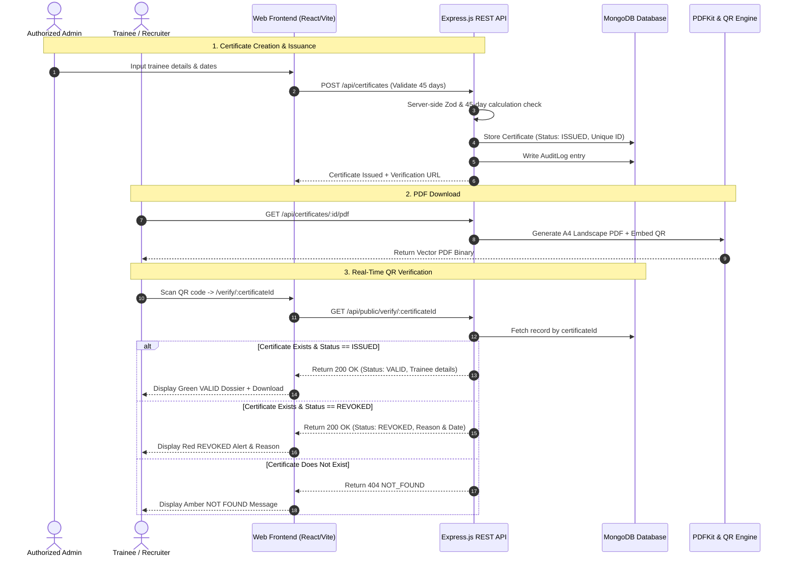

# Industrial Training Certificate Management & Verification System

[]()
[]()
[]()

A complete, enterprise-grade corporate web application and central verification registry for companies that issue and verify **45 Days Industrial Training Certificates**.

Authorized administrators can create, edit, issue, revoke, and export tamper-evident certificates with high-resolution vector A4 landscape PDFs and unique cryptographic QR codes. When scanned by recruiters or universities, the QR code redirects to an authenticated public verification page displaying real-time validity, trainee credentials, 45-day duration validation, and authorized signatory details.

---

## 📑 Table of Contents

- [Key Architectural Highlights](#key-architectural-highlights)
- [Technology Stack](#technology-stack)
- [System Architecture & Flow](#system-architecture--flow)
- [45-Day Duration Policy & Validation](#45-day-duration-policy--validation)
- [Project Directory Structure](#project-directory-structure)
- [Quick Start Guide](#quick-start-guide)
- [Pre-Configured Demo Records](#pre-configured-demo-records)
- [Administrator Setup & Security](#administrator-setup--security)
- [REST API Reference](#rest-api-reference)
- [Automated Testing](#automated-testing)
- [Production Deployment](#production-deployment)
- [Accreditation & Integrity Notice](#accreditation--integrity-notice)

---

## 🌟 Key Architectural Highlights

1. **Cryptographic Real-Time QR Verification**:
   - Every certificate embeds a scannable QR code generated server-side.
   - Redirects to a live verification endpoint (`/verify/:certificateId`).
   - Distinguishes **VALID**, **REVOKED**, or **NOT FOUND** statuses directly from MongoDB.
   - Zero reliance on physical paper or static claims.

2. **Automated Strict 45-Day Duration Enforcement**:
   - Compares training start and completion calendar dates against company counting policy (`INCLUSIVE`: Start Date + End Date = 45 days).
   - Server-side rejection of invalid spans with clear feedback.
   - Client-side auto-calculation helper (+44 calendar days) with live validity indicator.

3. **High-Resolution A4 Landscape PDF Engine**:
   - Vector-rendered using `pdfkit`.
   - Dual navy blue (`#0f1f38`) and gold (`#b8860b`) borders with corner bracket accents.
   - High-fidelity typography, embedded QR code bitmap, official signature line, and registry serial IDs.
   - Fully printable via digital download or in-browser `@media print` layout.

4. **Immutable Audit Trail & Controlled Reissues**:
   - Sensitive actions (`CERTIFICATE_ISSUED`, `CERTIFICATE_REVOKED`, `CERTIFICATE_AMENDED`) are permanently logged with administrator ID, timestamp, and IP.
   - Revocation requires a mandatory reason (minimum 5 characters).
   - Once issued, certificates cannot be silently modified without a documented amendment reason.

5. **Enterprise Corporate SaaS Aesthetics**:
   - Professional corporate white, navy blue, and subtle gold palette.
   - Responsive across mobile, tablet, and widescreen desktop monitors.
   - Interactive live certificate preview panel updates in real-time as the administrator types.

---

## 🛠 Technology Stack

| Layer | Technologies |
| :--- | :--- |
| **Frontend** | React 18, Vite, Tailwind CSS, Lucide React, React Router v6 |
| **Forms & Validation** | React Hook Form, Zod Schema Validation |
| **Backend** | Node.js (ESM), Express.js, Helmet, Morgan, Cookie-Parser, CORS |
| **Database** | MongoDB with Mongoose ODM (includes embedded persistent engine fallback) |
| **Authentication** | JWT (JSON Web Tokens), bcryptjs password hashing, secure HTTP-only cookies |
| **PDF Generation** | PDFKit vector document engine |
| **QR Generation** | QRCode (High error correction level `H`) |
| **Testing** | Node.js native test runner (`node:test`, `node:assert/strict`) |

---

## 📐 System Architecture & Flow



---

## ⏱ 45-Day Duration Policy & Validation

Industrial training curricula for accredited universities require exactly 45 calendar days.

- **Inclusive Policy (Standard Default)**:
  $$\text{Duration} = \left\lfloor\frac{\text{Date}_{\text{end}} - \text{Date}_{\text{start}}}{86{,}400{,}000}\right\rfloor + 1$$
- **Example Valid Span**:
  - Training Start: `June 1, 2026`
  - Training End: `July 15, 2026`
  - 30 days in June + 15 days in July = **45 Days**.
- If a client attempts to submit fewer (e.g. 30 days) or more (e.g. 60 days), the server returns HTTP `400 Bad Request` with:
  ```json
  {
    "success": false,
    "message": "Configured duration requires exactly 45 days. Current dates span 30 days.",
    "calculatedDays": 30
  }
  ```

---

## 📂 Project Directory Structure

```
industrial-training-certificate/
├── package.json                   # Root orchestrator scripts
├── .env.example                   # Environment variable template
├── README.md                      # Comprehensive documentation
├── backend/                       # Express.js REST API
│   ├── package.json               # Backend dependencies
│   ├── .env                       # Backend active environment
│   ├── tests/
│   │   └── system.test.js         # Automated end-to-end integration tests
│   └── src/
│       ├── server.js              # Server entry point & middleware mounting
│       ├── config/
│       │   ├── config.js          # Environment config wrapper
│       │   └── db.js              # MongoDB connection & persistent fallback
│       ├── models/
│       │   ├── Admin.js           # Admin accounts with bcrypt password hashing
│       │   ├── Certificate.js     # Certificate records with indexes & history
│       │   ├── CompanySettings.js # Organization branding & signatory config
│       │   └── AuditLog.js        # Immutable audit logging schema
│       ├── middleware/
│       │   ├── auth.js            # JWT verification & role authorization
│       │   ├── rateLimiter.js     # Rate limiting for auth & public verification
│       │   ├── validate.js        # Zod validation middleware
│       │   └── errorHandler.js    # Secure error formatting (no leak of secrets)
│       ├── controllers/
│       │   ├── authController.js
│       │   ├── certificateController.js
│       │   ├── publicController.js
│       │   ├── companyController.js
│       │   └── auditLogController.js
│       ├── routes/
│       │   ├── authRoutes.js
│       │   ├── certificateRoutes.js
│       │   ├── publicRoutes.js
│       │   ├── companyRoutes.js
│       │   └── auditLogRoutes.js
│       ├── services/
│       │   ├── certService.js     # Unique ID generation & 45-day calculation
│       │   ├── pdfService.js      # A4 Landscape PDF vector rendering
│       │   └── qrService.js       # QR code buffer & data URL generation
│       ├── utils/
│       │   └── validators.js      # Zod request validation schemas
│       └── scripts/
│           ├── seedAdmin.js       # Standalone admin creation script
│           └── seedDemoData.js    # Demo database initialization script
└── frontend/                      # React.js + Vite Application
    ├── package.json               # Frontend dependencies
    ├── vite.config.js             # Vite configuration with /api proxy
    ├── tailwind.config.js         # Custom enterprise navy & gold theme
    ├── index.html                 # HTML template with Google Fonts
    └── src/
        ├── main.jsx               # React entry point
        ├── App.jsx                # Router & Provider wrapper
        ├── index.css              # Tailwind directives & @media print styles
        ├── services/
        │   └── api.js             # Axios instance with credentials & interceptors
        ├── context/
        │   ├── AuthContext.jsx    # Authentication state management
        │   └── ToastContext.jsx   # Toast notification provider
        ├── components/
        │   ├── Navbar.jsx         # Corporate header & responsive mobile drawer
        │   ├── Footer.jsx         # Enterprise footer & integrity notice
        │   ├── CertificatePreview.jsx # High-res interactive certificate renderer
        │   ├── RevokeModal.jsx    # Mandatory reason revocation modal
        │   ├── StatusBadge.jsx    # Visual status pills (VALID, REVOKED, DRAFT)
        │   ├── StatsCard.jsx      # Dashboard metric card
        │   └── ProtectedRoute.jsx # Route authorization guard
        └── pages/
            ├── Home.jsx           # Landing page with instant verification lookup
            ├── About.jsx          # Company background, mission & 45-day pedagogy
            ├── Verify.jsx         # Public verification desk & QR destination
            ├── Contact.jsx        # Public contact form & office details
            └── admin/
                ├── Login.jsx              # Secure administrator login
                ├── Dashboard.jsx          # Real-time analytics & recent events
                ├── CertificateList.jsx    # Search, filter, pagination & actions
                ├── CertificateCreate.jsx  # 45-day date validation & live preview
                ├── CertificateDetails.jsx # Full dossier, PDF export, amendments
                ├── CompanySettings.jsx    # Branding, signatory & verification domain
                └── AuditLogs.jsx          # Immutable audit trail
```

---

## 🚀 Quick Start Guide

### Prerequisites
- Node.js (v18 or higher recommended; developed and tested on Node 20 / 26)
- npm (v9 or higher)
- Optional: Local MongoDB instance (The backend includes an automatic persistent embedded MongoDB engine, so external MongoDB is **not required** to run out of the box).

### 1. Clone & Enter Directory
```bash
cd "industrial traning certificate"
```

### 2. Configure Environment
Backend settings are pre-configured in `backend/.env`. You can modify secrets or port numbers if desired:
```bash
cp .env.example backend/.env
```

### 3. Initialize Demo Data
Initialize the administrator and sample valid, revoked, and draft certificates:
```bash
npm run seed:demo
```

### 4. Run the Development Servers
In two separate terminal tabs:

**Tab 1: Backend Server (Port 5000)**
```bash
cd backend
npm start
```

**Tab 2: Frontend Client (Port 5173)**
```bash
cd frontend
npm run dev
```

Open your browser to: **`http://localhost:5173`**

---

## 🎯 Pre-Configured Demo Records

The system includes pre-seeded demonstration records marked clearly as **DEMO**:

### 1. Administrator Account
- **Portal Login URL**: `http://localhost:5173/admin/login`
- **Email**: `admin@nexora-tech.com`
- **Password**: `Admin@Pass2026!`
- *(Or click the "Auto Fill" button on the login screen)*

### 2. Demo Certificates for Testing
| Certificate ID | Trainee Name | Training Domain | Status | Verification URL |
| :--- | :--- | :--- | :--- | :--- |
| **`CERT-2026-0001`** | Aarav Patel | Full Stack Cloud Native Web Architecture | **VALID (ISSUED)** | [Inspect Valid Record](http://localhost:5173/verify/CERT-2026-0001) |
| **`CERT-2026-0002`** | Priya Sundaram | Applied Generative AI & Deep Learning | **VALID (ISSUED)** | [Inspect Valid Record](http://localhost:5173/verify/CERT-2026-0002) |
| **`CERT-2026-0003`** | Rohan Mehra | DevOps & Kubernetes Infrastructure | **REVOKED** | [Inspect Revoked Record](http://localhost:5173/verify/CERT-2026-0003) |
| **`CERT-2026-0004`** | Ananya Sharma | Embedded IoT & Edge AI Firmware | **DRAFT** | Managed in Admin Console |

---

## 🔒 Administrator Setup & Security

- **No Public Registration**: Administrator accounts can only be provisioned via server CLI script or existing superadmins.
- **Password Hashing**: Passwords are cryptographically salted and hashed using `bcryptjs` (salt rounds: 10).
- **Session Protection**: JWT tokens are transmitted via `httpOnly`, `sameSite`, and `secure` (in production) cookies, with optional Authorization header bearer support.
- **Rate Limiting**:
  - `POST /api/auth/login`: 10 attempts per 15-minute window.
  - `GET /api/public/verify/:id`: 60 requests per minute.
- **Audit Logging**: Every issuance, amendment, status change, and administrative login is stamped with the admin ID, timestamp, and IP.

To create an additional administrator via CLI:
```bash
cd backend
ADMIN_EMAIL="supervisor@nexora-tech.com" ADMIN_PASSWORD="SecurePassword2026!" ADMIN_NAME="Chief Officer" npm run seed
```

---

## 📡 REST API Reference

### Public Endpoints
| Method | Endpoint | Description |
| :--- | :--- | :--- |
| `GET` | `/api/health` | Service health status check |
| `GET` | `/api/public/verify/:certificateId` | Public verification record (Sanitized; no secrets) |
| `GET` | `/api/public/verify/:certificateId/pdf` | Download official PDF if enabled by administrator |
| `POST` | `/api/public/contact` | Submit contact / registrar inquiry |
| `GET` | `/api/company` | Retrieve public company branding & signatory |

### Authentication Endpoints
| Method | Endpoint | Description |
| :--- | :--- | :--- |
| `POST` | `/api/auth/login` | Administrator login (rate-limited) |
| `POST` | `/api/auth/logout` | Clear auth cookie & log logout |
| `GET` | `/api/auth/me` | Retrieve active admin profile |

### Protected Administrative Endpoints (Requires Auth)
| Method | Endpoint | Description |
| :--- | :--- | :--- |
| `GET` | `/api/certificates/stats` | Dashboard statistics & analytics |
| `GET` | `/api/certificates` | Search & filter certificate ledger (Pagination) |
| `POST` | `/api/certificates` | Create new certificate (Enforces 45 days) |
| `GET` | `/api/certificates/:certificateId` | Retrieve complete dossier & amendment history |
| `PATCH` | `/api/certificates/:certificateId` | Amend certificate (Mandatory reason required) |
| `POST` | `/api/certificates/:certificateId/issue` | Transition draft certificate to ISSUED |
| `POST` | `/api/certificates/:certificateId/revoke` | Revoke certificate (Mandatory reason required) |
| `GET` | `/api/certificates/:certificateId/pdf` | Generate & download A4 Landscape PDF |
| `PATCH` | `/api/company` | Update company settings, logo, & prefix |
| `GET` | `/api/audit-logs` | Retrieve immutable system audit trail |

---

## 🧪 Automated Testing

The project includes an automated end-to-end integration test suite using Node.js's built-in test runner.

To execute tests:
```bash
npm run test
```
Or directly in the backend folder:
```bash
cd backend
node --test tests/system.test.js
```

### Verified Test Cases
✔ 1. Database Connection & In-Memory Storage Initialization  
✔ 2. Training Date & 45-Day Duration Rule Validation  
✔ 3. Unique Certificate ID Generation & Duplicate Prevention  
✔ 4. Certificate Issuance Workflow  
✔ 5. Certificate Revocation with Mandatory Reason  
✔ 6. High-Resolution QR Code Generation  
✔ 7. A4 Landscape PDF Generation (Magic Byte Verification)  
✔ 8. Graceful Teardown & Disconnection  

---

## 🚢 Production Deployment

### 1. Build Frontend Static Assets
```bash
npm run build
```
The optimized bundle is written to `frontend/dist/`.

### 2. Environment Variables for Production
Set these in your host environment (e.g. AWS ECS, DigitalOcean, Heroku, Render):
```env
PORT=5000
NODE_ENV=production
MONGODB_URI=mongodb+srv://<user>:<password>@cluster.mongodb.net/cert_system?retryWrites=true&w=majority
USE_MEMORY_DB=false
JWT_SECRET=generate_a_64_character_random_string_here
COOKIE_SECRET=generate_another_random_string_here
CLIENT_URL=https://yourcompany-portal.com
PUBLIC_VERIFY_BASE_URL=https://yourcompany-portal.com/verify
```

### 3. Serving Frontend & Backend
You can serve the frontend static bundle directly with Nginx, Cloudflare Pages, or configure Express to serve `frontend/dist/` as static assets:
```javascript
// In backend/src/server.js (Optional production static serve)
app.use(express.static(path.join(__dirname, '../../frontend/dist')));
app.get('*', (req, res) => {
  res.sendFile(path.join(__dirname, '../../frontend/dist/index.html'));
});
```

---

## ⚖️ Accreditation & Integrity Notice

- Nexora Innovations generates credentials exclusively for students who complete verifiable training modules.
- This platform does **not** fabricate government accreditations, fake university stamps, or unauthorized regulatory affiliations.
- Credential authenticity is established via direct database record lookups and tamper-resistant cryptographic QR hashes.

---

*Engineered with precision for industrial training organizations, colleges, and enterprise engineering programs.*
